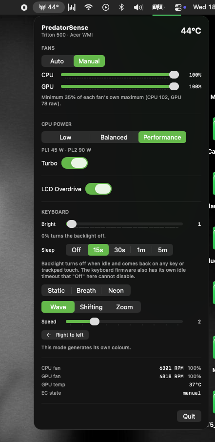

# Acer Predator Triton 500 (PT515-51) — macOS Tahoe Hackintosh + Custom PredatorSense App


A complete, working macOS Tahoe build for the **Acer Predator Triton 500 PT515-51**, plus a
**custom PredatorSense replacement** — kernel driver, root daemon and menu-bar app — for the
laptop's EC/WMI hardware that Acer never documented.

This repository is the full record: the EFI, every kext and patch, the custom app and the tutorial
for building your own, the custom AppleALC audio work, the display/EDID work, the Linux
cross-checks, the dead ends, and the method used to get here with AI assistants.

> **Status: working daily driver.** macOS Tahoe **26.7.2 (25G332)**, OpenCore 1.0.8, UHD 630
> acceleration, custom audio, Wi-Fi, battery, sleep, 144 Hz display, keyboard backlight,
> fan/turbo/RGB control. Verified on 2026-11-18.
>
> **Open items:** Bluetooth controller state is inconsistent on this unit (stack loads, address
> sometimes `NULL`) — see [`docs/NETWORK.md`](docs/NETWORK.md#bluetooth). Instant wake from USB
> with the lid open has a working workaround, not a fix — see
> [`docs/TROUBLESHOOTING.md`](docs/TROUBLESHOOTING.md#sleep-wakes-instantly-lid-open).


---

## Start here

New to this? Read **[docs/START-HERE.md](docs/START-HERE.md)** — it routes you to the right guide
in one click.

| If you want to… | Read |
|---|---|
| understand how a Hackintosh works at all | [Hackintosh 101](docs/HACKINTOSH-101.md) |
| build this on the same laptop | [Getting started](docs/GETTING-STARTED.md) |
| **build my own hardware-control app** | [Build your own PredatorSense](docs/BUILD-YOUR-OWN-APP.md) |
| keep an existing build stable | [Stability](docs/STABILITY.md) |
| fix one specific thing | [Troubleshooting](docs/TROUBLESHOOTING.md) |
| know exactly what is installed | [Known-good manifest](reference/KNOWN-GOOD.md) |
| understand this machine deeply | [Build reference](docs/BUILD-REFERENCE.md) |

Several configurations that look correct on paper are **wrong on this machine**. Every one was
disproved by testing on real hardware, and each is documented with its evidence in
[`docs/BUILD-REFERENCE.md`](docs/BUILD-REFERENCE.md#12-rejected-approaches--do-not-retry-without-new-evidence).
The recurring failure mode in this project was **confident inference from partial data**; the
corrections all came from hardware measurement — a Linux live USB, ACPI dumps, EC reads and MSR
reads. Do not re-attempt the rejected approaches without new evidence.

---

## Hardware

| Component | Detail |
|---|---|
| Model | Acer Predator Triton 500, **PT515-51** |
| CPU | Intel Core **i7-8750H** (Coffee Lake-H, 6C/12T, 45 W, locked) |
| Chipset | Intel **HM370** (Cannon Lake PCH-H) |
| iGPU | Intel **UHD Graphics 630**, device-id `3E9B` |
| dGPU | NVIDIA RTX 2060/2080 Max-Q — **physically dead on this unit**, hidden from PCI, disabled with `-wegnoegpu` |
| RAM | 16 GB DDR4-2667, dual channel |
| Storage | WDC PC SN720 512 GB NVMe (`[15b7:5002]`) |
| Display | BOE **NV156FHM-N4K** (EDID `BOE082A`), 15.6" 1920×1080 IPS, 144 Hz |
| Audio | Realtek **ALC289** (`VEN_10EC&DEV_0289&SUBSYS_1025132D`) |
| Wi-Fi | Intel **CNVi** `[8086:a370]` / Killer 1550i (9560NGW) — **CNVi, not a PCIe M.2 card** |
| Bluetooth | Intel 9460/9560 "Jefferson Peak" `[8087:0aaa]`, USB |
| Ethernet | Killer E3000 2.5GbE (`[10ec:3000]`, RTL8125 family) |
| Trackpad | Elantech **ELAN0504** (`04F3:3093`), I²C-HID on `\_SB.PCI0.I2C1.TPD0` |
| Keyboard | PS/2, 3-zone RGB backlight |
| EC | ACPI Embedded Controller at `\_SB.PCI0.LPCB.EC0` |
| BIOS | **V1.13** — do not update (see the reference doc) |
| SMBIOS used | `MacBookPro16,1` |

**Battery note:** the original battery is degraded on this unit (~76 % of design capacity,
"Service Recommended"). That is a hardware condition, not a macOS problem. A weak battery can
limit peak-power bursts; replace it if you need sustained performance on battery.

---

## What works

| Area | Status |
|---|---|
| Boot / install | OpenCore, built-in picker, fast boot (`ScanPolicy` set) |
| Graphics | UHD 630, Metal 3, 1920×1080 at 144 / 120 / 90 Hz |
| Audio | Internal speakers, internal mic, headphone jack — custom ALC289 layout 23 with EQ, +6 dB and limiter |
| Wi-Fi | AirportItlwm 2.3.0 + IOSkywalkFamily/IO80211FamilyLegacy |
| Bluetooth | Stack loads; controller state is inconsistent on this unit — open item, see [`docs/NETWORK.md`](docs/NETWORK.md#bluetooth) |
| Ethernet | LucyRTL8125Ethernet |
| Battery / charging | SMCBatteryManager |
| Sleep / wake | Works, including lid; USB wake quirks documented |
| Trackpad | VoodooI2C + VoodooI2CHID, polling mode |
| Keyboard | VoodooPS2 (keyboard only) |
| Keyboard backlight | 0–100 % slider in the menu-bar app |
| Fans | Manual/auto control, per-fan duty, thermal ceiling and watchdog |
| Turbo / power limits | PL2 90 W burst, PL1 45 W (firmware-enforced) |
| RGB | 3 zones, effects, speed, direction, brightness |
| Special keys | **Not possible on this firmware** — see [`docs/SPECIAL-KEYS.md`](docs/SPECIAL-KEYS.md) |

---

## Custom PredatorSense app

Acer ships PredatorSense for Windows only. This repository replaces it with three pieces of
original software, and documents the whole reverse-engineering method so the same approach works on
another laptop or a completely different device.

| Part | What it is |
|---|---|
| [`psec2/kext/`](psec2/kext/) | `PredatorSenseEC.kext` — IOKit driver for the Acer ACPI-WMI mapper, EC and MSRs |
| [`psec2/daemon/`](psec2/daemon/) | Root daemon — owns the hardware, persists state, watchdog, thermal ceiling |
| [`psec2/app/`](psec2/app/) | SwiftUI menu-bar app — fans, power profiles, RGB, keyboard backlight |

**The tutorial is [`docs/BUILD-YOUR-OWN-APP.md`](docs/BUILD-YOUR-OWN-APP.md).** It covers finding
the control path, decoding the ACPI-WMI interface, probing safely, writing the driver, designing a
UI that cannot brick the machine, and porting the method to Dell, Lenovo, HP, MSI, ASUS or a USB/HID
device. The reference implementation's command protocol is in
[`docs/PREDATORSENSE.md`](docs/PREDATORSENSE.md).

---

## Releases

Prebuilt packages are attached to [Releases](https://github.com/rojandotpro/PT515-51-Hackintosh/releases).
They are built from the source in this repository and checked against the live machine.

| Asset | Contents |
|---|---|
| `PredatorSense-1.0.0.zip` | The app, daemon, kext, LaunchDaemon plist and install notes |
| `PT515-51-EFI-1.0.0.zip` | The complete sanitized OpenCore EFI |
| `SHA256SUMS.txt` | Checksums for both archives |

> The EFI archive contains **placeholder** SMBIOS values. Generate your own before signing in to
> iCloud — see [Quick start](#quick-start) step 4.

---

## Quick start

You need a working macOS install to prepare the USB. Read
[`docs/GETTING-STARTED.md`](docs/GETTING-STARTED.md) for the full walkthrough.

1. **Back up** your current EFI and anything you cannot lose.
2. On the target laptop, set BIOS **V1.13**, disable Secure Boot/CSM, enable AHCI and Above 4G
   Decoding. Do **not** update the BIOS.
3. Copy `efi/` to a FAT32 USB stick as `EFI/` (or mount your ESP and copy it there).
4. **Before first boot**, generate your own SMBIOS identity with
   [GenSMBIOS](https://github.com/corpnewt/GenSMBIOS) and replace the placeholders in
   `efi/OC/config.plist` (`SystemSerialNumber`, `MLB`, `SystemUUID`, `ROM`). The values shipped here
   are deliberately fake and will not give you iServices.
5. Boot the USB, install macOS, then copy the EFI to the internal disk's ESP.
6. Build and install the PredatorSense stack:
   ```sh
   sudo ./psec2/build.sh
   ```
   See [`docs/PREDATORSENSE.md`](docs/PREDATORSENSE.md).

> The shipped EFI is a **starting point for the same hardware**, not a universal EFI. It assumes
> the same CPU/GPU/audio/Wi-Fi combination. Different panel, different Wi-Fi card or a different
> EC means different patches.

---

## Repository map

```
efi/                     Live OpenCore EFI (sanitized config, full kext set, ACPI, drivers, tools)
  OC/config.plist        OpenCore configuration — placeholders for SMBIOS identity
  OC/ACPI/               SSDTs used by this build
  OC/Kexts/              All kexts, including this project's PredatorSenseEC.kext
  OC/Drivers/            HfsPlus.efi, OpenRuntime.efi
  OC/Tools/              OpenCore shell tools
  OC/Resources/          Picker audio/icons
  BOOT/BOOTx64.efi
psec2/                   PredatorSense replacement: kext + daemon + app + build script
  kext/PredatorSenseEC/  IOKit driver: WMI + EC access
  daemon/                Root daemon: socket, state, watchdog, backlight idle
  app/PredatorSense/     SwiftUI menu-bar app
  build.sh               Builds and installs all three
audio/                   Custom AppleALC ALC289 layout 23 (EQ, gain, limiter, mute fix)
display/                 90 Hz EDID work, banding tests, panel audits, restore scripts
tools/                   Health check, EFI backup, audit collectors, Linux dumps, PL1 test
linux/                   Linux cross-check evidence (USB report, EDID decode)
docs/                    Guides and the full technical reference (see below)
reference/               Handovers, optimisation review, known-good manifest
```

### Documentation

| Document | What it is for |
|---|---|
| [`docs/START-HERE.md`](docs/START-HERE.md) | Choose your path, 60-second summary |
| [`docs/HACKINTOSH-101.md`](docs/HACKINTOSH-101.md) | The mental model: boot chain, kexts, ACPI, SMBIOS, SIP, glossary |
| [`docs/GETTING-STARTED.md`](docs/GETTING-STARTED.md) | Build it from zero, step by step |
| [`docs/BUILD-YOUR-OWN-APP.md`](docs/BUILD-YOUR-OWN-APP.md) | **Custom PredatorSense tutorial** — build a hardware-control app for any laptop |
| [`docs/STABILITY.md`](docs/STABILITY.md) | Backups, update playbook, monitoring, recovery |
| [`docs/TROUBLESHOOTING.md`](docs/TROUBLESHOOTING.md) | Symptom → cause → fix |
| [`docs/BUILD-REFERENCE.md`](docs/BUILD-REFERENCE.md) | Every measurement, reverse-engineered interface and rejected approach |
| [`docs/AI-WORKFLOW.md`](docs/AI-WORKFLOW.md) | The method, prompt patterns and guardrails used to build this |
| [`docs/AI-ATTRIBUTION.md`](docs/AI-ATTRIBUTION.md) | Which assistants were used, what the human did, licensing and trademark position |
| [`docs/PREDATORSENSE.md`](docs/PREDATORSENSE.md) | The custom driver stack and its command protocol |
| [`docs/AUDIO.md`](docs/AUDIO.md) | ALC289 layout 23, DSP chain, mute fix, rebuild |
| [`docs/DISPLAY.md`](docs/DISPLAY.md) | EDID override, refresh rates, banding, colour |
| [`docs/NETWORK.md`](docs/NETWORK.md) | Wi-Fi and Bluetooth stacks, post-update repair |
| [`docs/SPECIAL-KEYS.md`](docs/SPECIAL-KEYS.md) | Why the media keys cannot be intercepted |
| [`docs/MACOS27.md`](docs/MACOS27.md) | Why macOS 27 will not run here |
| [`reference/KNOWN-GOOD.md`](reference/KNOWN-GOOD.md) | Exact versions of every component, verified 2026-11-18 |

The **technical reference** — reverse-engineered WMI methods, EC registers, fan ordinals, MSR
values, audio pin mappings, EDID bytes, rejected approaches — is
[`docs/BUILD-REFERENCE.md`](docs/BUILD-REFERENCE.md). It is written so a person *or another AI
assistant* can pick this machine up cold.

---

## The PredatorSense replacement

Acer's Windows software controls fans, power profiles, RGB and the keyboard backlight through an
undocumented ACPI-WMI interface. This project replaces it with three components and **no
third-party dependencies**:



- **`PredatorSenseEC.kext`** — IOKit driver that talks to ACPI `\_SB.PCI0.WMID.WMBH` and the EC.
- **`predatorsensed`** — root daemon that owns the kext, exposes a UNIX socket and persists settings.
- **`PredatorSense.app`** — SwiftUI `MenuBarExtra` app; the GUI never touches IOKit.

Highlights:

- Fan control with per-fan duty, a **thermal ceiling at 88 °C**, a **6 s keepalive watchdog**, and
  automatic fallback to the EC's own curve if the daemon dies.
- **PL2 90 W / 28 s** burst, PL1 left at the firmware's 45 W because the EC enforces 45 W below the
  OS (proven — see the reference doc).
- Keyboard backlight **0–100 %** mapping that matches the hardware's real 25–100 visible range,
  including auto-dim and an idle re-assert that never fights an explicit "off".
- RGB zones mapped correctly (left/middle/right = 1/2/4; zone 3 is not wired).

Details and the full protocol: [`docs/PREDATORSENSE.md`](docs/PREDATORSENSE.md).

---

## Audio: custom ALC289 layout 23

Layout 23 is the correct pin layout for this machine, proven by testing (layout 33 kills the
internal mic). On top of it this build adds:

- a **Maxx-style EQ**, **2× gain (+6 dB)** and a **limiter** on the internal speaker;
- a **+10 dB** internal-mic pin boost with noise reduction;
- the **mute-key fix** — mute flags moved to the correct pins (speaker/headphone), volume on the
  DACs.

Sources and build steps: [`audio/`](audio/) and [`docs/AUDIO.md`](docs/AUDIO.md).
Do **not** set `AFGLowPowerState` to 0 — the internal mic disappears.

---

## Display: native EDID, 90/120/144 Hz

The panel is a BOE NV156FHM-N4K, 8-bit SDR, 144 Hz. macOS reads only the four base-block DTDs, so
extra refresh rates are added by keeping the same pixel clock and horizontal total and lengthening
the vertical blanking.

- 144 Hz — best for UI and work.
- **120 Hz** — best all-round: divides 24/30/60 fps evenly, so video does not judder.
- 90 Hz — works, but judders on 24/60 fps video; useful for power saving.

The gradient banding in some macOS UI is believed to be the panel's default 8-bit behaviour, not a
framebuffer problem. Details, EDID blobs and restore scripts: [`display/`](display/) and
[`docs/DISPLAY.md`](docs/DISPLAY.md).

---

## Wi-Fi and Bluetooth

This machine has **CNVi** Wi-Fi, not an M.2 PCIe card, so a Broadcom swap is probably not possible.
The working stack is:

- `AirportItlwm 2.3.0` + `IOSkywalkFamily` + `IO80211FamilyLegacy`,
- Kernel → Block: `com.apple.iokit.IOSkywalkFamily`, `Exclude`, `MinKernel 23.0.0`, `x86_64`,
- `csr-active-config = 03080000`,
- `SecureBootModel = Disabled`,
- and the OCLP-Mod Intel Wi-Fi root patch, which **must be re-applied after every macOS update**.

The exact steps used to repair Wi-Fi after 26.7.1 were done in a ChatGPT session and were not
recorded. If you know them, please open a PR against
[`docs/NETWORK.md`](docs/NETWORK.md) — the likely steps are listed there.

Bluetooth needs the matched 2.5.1 set (`IntelBluetoothFirmware` + `IntelBTPatcher`), with
`IntelBluetoothInjector` disabled.

---

## Performance notes

Measured on this unit:

- PL1 is **45 W** in every profile; only PL2 changes (firmware/EC cap, proven).
- Manual fans at 100 % keep it cool but are loud and unnecessary at idle; auto mode is fine for
  daily use.
- 120 Hz is the best compromise; 144 Hz costs more WindowServer work on the UHD 630.
- The project volume in this build is an **external USB exFAT disk** (~354 MB/s write) — builds are
  several times faster on the internal NVMe (~2 GB/s). Keep a working copy internally.
- Spotlight is disabled on the internal volume, and indexing external volumes adds USB churn.
- The battery is degraded; see the note above.

Do **not** apply generic "optimizations": RAM cleaners, periodic purge, swap disabling, blanket
service disabling, forced NVMe ASPM or arbitrary framebuffer changes. The reasoning is in
[`reference/OPTIMIZATION-REVIEW-2026-10-10.md`](reference/OPTIMIZATION-REVIEW-2026-10-10.md).

---

## macOS 27 and the future

Apple's macOS 27 ("Golden Gate") is **Apple Silicon only**. OpenCore Legacy Patcher has said it
will not support it. Two experimental community projects exist — `hao-patcher`/`hao-runtime`
(ARM→x86 translation) and NullMoth's Liberator/NVIDIA driver — but neither supports this laptop
today, and both trade performance and security for the experiment.

Tahoe is the end of the line for this hardware. Read
[`docs/MACOS27.md`](docs/MACOS27.md) before spending time on it.

---

## How this was built (and how you can do it)

The method matters as much as the result. The short version:

1. **Measure, don't guess.** A Linux live USB (`lspci`, `lsusb`, `acpidump`, MSR reads) settled
   questions that macOS could not.
2. **Change one variable at a time.** Keep a bootable USB and a known-good EFI.
3. **Use AI as a research assistant and pair debugger, not an oracle.** It is excellent at reading
   ACPI dumps, diffing configs, writing scripts and finding patterns; it is not a source of
   hardware facts.
4. **Verify every claim against the machine.** Every "obvious" answer that failed here is recorded.

The full workflow, prompts and guardrails are in [`docs/AI-WORKFLOW.md`](docs/AI-WORKFLOW.md).

---

## Credits

Built on the work of [OpenCore](https://github.com/acidanthera/OpenCorePkg),
[Lilu](https://github.com/acidanthera/Lilu), [VirtualSMC](https://github.com/acidanthera/VirtualSMC),
[WhateverGreen](https://github.com/acidanthera/WhateverGreen),
[AppleALC](https://github.com/acidanthera/AppleALC), [VoodooI2C](https://github.com/VoodooI2C),
[VoodooPS2](https://github.com/acidanthera/VoodooPS2), [itlwm](https://github.com/OpenIntelWireless/itlwm),
[IntelBluetoothFirmware](https://github.com/OpenIntelWireless/IntelBluetoothFirmware),
[USBToolBox](https://github.com/USBToolBox), [NVMeFix](https://github.com/acidanthera/NVMeFix),
[CPUFriend](https://github.com/acidanthera/CPUFriend),
[RestrictEvents](https://github.com/acidanthera/RestrictEvents),
[AMFIPass](https://github.com/dhinakg/AMFIPass), and the Dortania guides.

Third-party licences are listed in [`NOTICE.md`](NOTICE.md). Original code and documentation in
this repository are MIT licensed — see [`LICENSE`](LICENSE).

---

## Disclaimer

Hackintosh setups can break with any macOS or firmware update, and can damage data. Back up
everything. This repository documents one working machine; it is not a warranty that the same
configuration will work on yours. macOS is Apple's software — you are responsible for how you use
it.
