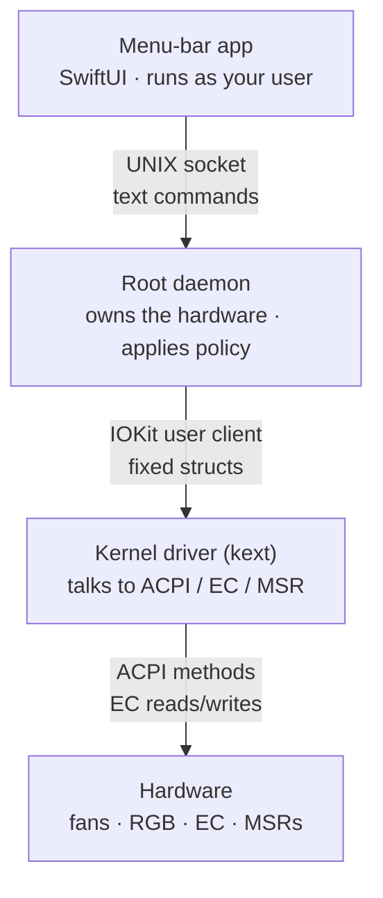
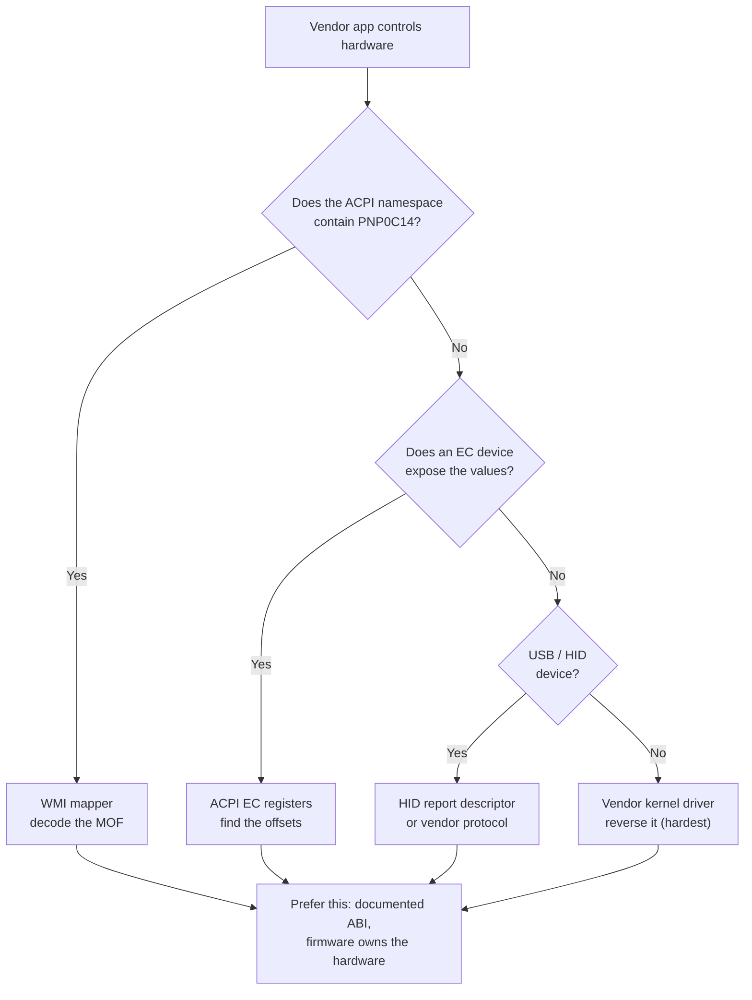

# Custom PredatorSense App — build your own hardware controller

**A complete tutorial for replacing a vendor's Windows-only hardware control app on macOS, using a
compatible laptop as the example.**

This is the workflow that produced the PredatorSense replacement in this repository: a kernel
driver, a root daemon and a menu-bar app that control fans, power profiles, keyboard RGB and the
backlight on an Acer Predator Triton 500. **The method is portable; the code is not.** It applies to
another laptop, another vendor or a different device only when that hardware exposes a control path
the OS can reach — and each value must still be measured on that machine. Section
[1.1](#11-compatibility-what-transfers-and-what-does-not) separates what transfers from what has to
be rediscovered.

It is written so you can follow it end to end, and so an AI assistant can help you without
inventing hardware facts.

> **Scope warning.** You will be writing a kernel driver and touching firmware interfaces that the
> vendor never documented, possibly never intended anyone to call. A wrong EC write can hang or
> damage the machine. Read [Safety](#9-safety-rules-that-are-not-optional) before you write
> anything.

---

## Contents

| | |
|---|---|
| [1. What you are building](#1-what-you-are-building) | [7. The app](#7-the-app) |
| [2. What you need](#2-what-you-need) | [8. Build, install, iterate](#8-build-install-iterate) |
| [3. Find the control path](#3-find-the-control-path) | [9. Safety rules that are not optional](#9-safety-rules-that-are-not-optional) |
| [4. Reverse the interface](#4-reverse-the-interface) | [10. Test like it can hurt you](#10-test-like-it-can-hurt-you) |
| [5. Probe before you build](#5-probe-before-you-build) | [11. Port it to another laptop](#11-port-it-to-another-laptop) |
| [6. Write the driver](#6-write-the-driver) | [12. Package and publish](#12-package-and-publish) |

---

## 1. What you are building

Three processes, one job each. This shape is not arbitrary — it is what keeps a hardware control
app safe and maintainable.



| Layer | Why it exists | What it must never do |
|---|---|---|
| **App** | A UI you actually want to use | Touch IOKit or run as root |
| **Daemon** | One owner of the hardware, persists settings, enforces safety limits | Contain UI logic |
| **Kext** | The only place that can call ACPI/EC safely | Make policy decisions |

The reason for the split is failure containment. If the app crashes, the daemon keeps the fans
where they belong. If the daemon dies, the kext reverts to firmware control. The kernel never has
to know what a slider is.

**The method transfers.** Whether your target is fan curves, RGB, battery thresholds, a
performance toggle or a hardware button, the questions are the same:

1. Which OS interface does the firmware expose?
2. What are its exact methods, argument widths and status codes?
3. How do I call them safely from a driver?
4. How do I expose that to a user without letting them brick the machine?

### 1.1 Compatibility: what transfers and what does not

A hardware-control project works on **compatible hardware**, meaning hardware that exposes a usable
control path. It is not a matter of installing the same code on a different laptop. The method is a
way to find out whether your machine is compatible — and where.

| Target | What transfers | What must be verified |
|---|---|---|
| **This exact model** — PT515-51, BIOS V1.13, macOS 26.7.2 | The whole stack, with the documented caveats | Nothing; this is the measured reference |
| Another PT515-51 with a different panel, Wi-Fi card or EC revision | Architecture and most patches | Device IDs, EDID, Wi-Fi, thermals |
| Another Acer Predator using the same `AcerGamingFunction` WMI class | The kext skeleton and driver shape | Method IDs, argument widths, fan ordinals, zone map |
| A different vendor (Dell, Lenovo, HP, MSI, ASUS) | The method and the three-layer architecture | The control path, the protocol, every value and limit |
| RGB keyboard or cooler that is a standard HID device | The daemon/UI pattern | The report descriptor; you may need no kext at all |
| Hardware with no OS-visible control path, or firmware that locks it | Nothing | It is not supported; no userspace trick creates a path |
| Apple Silicon or non-x86 | Nothing in this kext | Different architecture, different drivers |

**A compatibility claim is a test result, not an intention.** Publish support for a model only after
you have booted it, exercised every control, killed the daemon, and confirmed the fallback. Section
[11](#11-port-it-to-another-laptop) is the checklist.

---

## 2. What you need

### Knowledge

You do not need to be a kernel developer. You do need to be comfortable with:

- reading C/C++ and a little assembly,
- the shell, `ioreg`, `log show`,
- the idea of a memory-mapped register and a fixed-width integer.

Everything else is in this tutorial.

### Tools

| Tool | Purpose | Where |
|---|---|---|
| **`iasl`** | Decompile ACPI tables to readable ASL | ACPICA |
| **`acpidump`** | Dump firmware tables (Linux) | `acpica-tools` |
| **`bmfdec`** | Decode the binary MOF behind WMI | [pali/bmfdec](https://github.com/pali/bmfdec) |
| **Linux live USB** | Ground truth for PCI, USB, EC and codec | any distro |
| **`ec_sys` / `acpi_listen` / `evtest`** | Observe EC and input events from Linux | kernel modules |
| **Ghidra / IDA** | Reverse a vendor kernel driver or service, if needed | optional |
| **Hex Fiend** | Inspect firmware blobs and descriptors | optional |
| **Xcode Command Line Tools** | Compile the kext, daemon and app | Apple |
| **`ioreg`, `kmutil`, `log`** | Verify what actually loaded | macOS |

### A second machine

You will reboot a lot. Keep this tutorial and your notes on another screen or device.

---

## 3. Find the control path

Vendors use one or more of these. You must find out **which one your model uses** before writing
code. Test on the real machine; do not infer from a similar model.



### 3.1 Dump the ACPI namespace

On Linux (the easiest place to do it):

```sh
sudo acpidump -o tables
# or, on macOS, from a booted system with the debug tools:
#   ioreg -l -w0 | grep -i acpi
```

Decompile everything:

```sh
mkdir asl && cd asl
iascp=""; for f in ../tables/*.dat; do iasl -d "$f" 2>/dev/null; done
ls *.dsl
```

Search for the vendor's fingerprint:

```sh
grep -l -i -E 'PNP0C14|WMI|WMID|WMBH' *.dsl
grep -n -i -E 'fan|rgb|led|backlight|profile' *.dsl | head -50
```

### 3.2 Identify the WMI mapper

Vendors put WMI under a `PNP0C14` device, usually with a name like `WMID`, `WMI0`, `AMW0` or
`ACPI\PNP0C14`. Open it and look for:

- `_WDG` — the WMI GUID mapping table,
- a method that takes `(instance, methodId, buffer)`, often `WMBH` or `WMBA`,
- a binary MOF object (`WQxx` / `WSxx`) containing method names and types.

On this laptop:

```
Device: \_SB.PCI0.WMID        (PNP0C14, validates WMBH)
Call  : WMBH(instance, methodId, buffer)
GUID  : {7A4DDFE7-5B5D-40B4-8595-4408E0CC7F56}
Class : AcerGamingFunction
```

**There were four `PNP0C14` devices.** Three were Intel stubs (`WMTF`, `WFDE`, `WFTE`) and only
one exposed `WMBH`. That is why the driver enumerates every match and calls
`validateObject("WMBH")` instead of taking the first one:

```cpp
// psec2/kext/PredatorSenseEC/PredatorSenseEC.cpp — excerpt
OSDictionary *match = IOService::nameMatching("PNP0C14");
OSIterator *it = IOService::getMatchingServices(match);
while (IOACPIPlatformDevice *dev = ...) {
    if (dev->validateObject("WMBH") == kIOReturnSuccess) {
        fWMI = dev;   // this is the vendor mapper
        break;
    }
}
```

### 3.3 Or: read the EC directly

If there is no WMI device, the vendor app may talk to the **Embedded Controller**. In ACPI you
will see an `OperationRegion (..., EmbeddedControl, ...)` and named fields:

```asl
OperationRegion (RAM, EmbeddedControl, 0, 0xFF)
Field (RAM, ByteAcc, Lock, Preserve) {
    F1ST, 8,   // fan 1 status
    F1WS, 8,   // fan 1 duty
    F1RS, 8,   // fan 1 tach
    ...
}
```

Linux exposes the same registers:

```sh
sudo modprobe ec_sys write_support=0
sudo cat /sys/kernel/debug/ec/ec0/io | xxd | head
```

On this machine, `F1WS`/`F2WS` are duty setpoints and `F1RS`/`F2RS` are tachometers, with
`RPM = 0x78000 / tach`.

> **Warning about direct EC writes.** On this laptop the EC's own loop rewrote `F1ST` back within
> one poll interval, so writes silently did nothing. The firmware's WMI method was the only
> authoritative path. Check whether your EC writes actually stick before building on them.

### 3.4 Or: USB/HID

Keyboards, mice, coolers and RGB controllers often speak HID. On Linux:

```sh
lsusb -v -d VID:PID        # report descriptor
sudo evtest                # decoded events
sudo usbhid-dump -e descriptor
```

If it is a standard HID device, you may not need a kext at all — a userspace daemon using
`IOHIDManager` can do the job, with no kernel code and no security risk.

---

## 4. Reverse the interface

You have found the door. Now map every lock on it.

### 4.1 Decode the MOF

The method names and argument types live in a binary MOF blob inside ACPI. Extract the object
(here `WQAB`) and decode it:

```sh
# bmfdec reads the MOF binary; see the project README for extraction
./bmfdec < WQAB.bin > acer-gaming.mof.txt
```

You get a class with typed methods:

```mof
class AcerGamingFunction {
    uint64 SetGamingProfile(uint64);
    uint32 GetGamingProfile(uint32);
    uint64 SetGamingRgbKb(uint32);
    uint64 SetGamingKBBacklight(uint8[16]);
    ...
};
```

### 4.2 Argument width is everything

> **The single most expensive fact in this project:** the firmware validates the *byte length* of
> the buffer against the MOF-declared type. Eight bytes sent to a `uint32` method **fails
> silently**. The first driver sent 8 bytes to every method; RGB never worked and nothing said why.

| Declared type | Bytes to send |
|---|---|
| `uint8[16]` | 16 |
| `uint32` | 4 |
| `uint64` | 8 |

The working method table on this laptop (23 methods, no overclocking):

| ID | Method | In | Bytes |
|---|---|---|---|
| 1 | SetGamingProfile | uint64 | 8 |
| 2 | SetGamingLED | uint64 | 8 |
| 3/4 | Get GamingProfile / LED | uint32 | 4 |
| 6/7 | Get/Set RGB keyboard | uint32 | 4 |
| 14/15 | Get/Set fan behaviour | uint64 / uint32 | 8 / 4 |
| 16/17 | Get/Set fan speed | uint64 / uint32 | 8 / 4 |
| 20 | Set keyboard backlight | uint8[16] | 16 |
| 21 | Get keyboard backlight | uint32 | 4 |

The full table is in [`BUILD-REFERENCE.md`](BUILD-REFERENCE.md#32-method-table--argument-width-is-critical).

### 4.3 Find the status convention

Every call returns a buffer. On this firmware the **first output byte is the status**:

```
0x00 = success
0x01 = firmware error (bad method, bad argument, unsupported value)
```

You establish this by calling a **known-good method** as a control, then a deliberately bad one.
Do not assume it; other vendors return a length, an error code at a different offset, or nothing.

### 4.4 Map values by experiment, not by intuition

Three examples from this project where the obvious answer was wrong:

| Guess | Measurement |
|---|---|
| Fan ordinals are CPU=1, GPU=2 | Only ordinals **1 and 4** exist; 1 = GPU, 4 = CPU |
| Fan 2 sensors report fan 2 | Sensor channels are **crossed**: `F2*` reports the **CPU** fan |
| Zones are 1,2,3 | Indices are **1, 2, 4**; index 3 is not wired |

The method: change **one** actuator, watch **all** sensors, and write down the mapping. Never
derive a fan ordinal from its position in the vendor UI.

### 4.5 Capture the firmware's own sequence

For fan control, the ACPI table contains the vendor's own `SFMS` (set fan speed) method. Read it —
it tells you the exact register sequence and the mode bits:

```asl
// Acer's own method, simplified
F1ST = 0x14        // bit 0x10 = manual override
F1WS = <duty>
```

Copy that sequence. Do not invent one, and **capture the pre-write mode byte** so you can restore
exactly what was there.

---

## 5. Probe before you build

Building a kext to test a hypothesis is slow. Probe from userspace or Linux first.

### 5.1 Read-only first

1. **Read** every value you intend to write, and log it over time (idle, load, sleep).
2. Change the hardware through the **vendor app or firmware hotkey**, and see which registers move.
3. Only then attempt a write, to a value you have already observed the firmware use.

A short probe harness on Linux:

```sh
# watch fan tachometers and duty while the vendor tool changes modes
while true; do
  sudo cat /sys/kernel/debug/ec/ec0/io | xxd -s 0x90 -l 16
  sleep 1
done
```

On macOS, the same idea through ACPI:

```sh
# after the driver exists, the daemon's escape hatch is the fastest probe
echo "ecread 93" | nc -U /var/run/predatorsense.sock
echo "wmi 3 00000000" | nc -U /var/run/predatorsense.sock
```

### 5.2 Build a probe path into the product

The daemon in this repository keeps `ecread`, `ecwrite` and `wmi` commands permanently. They are
the difference between "rebuild and reboot to test one byte" and "test it now". Keep them, and keep
them root-only.

### 5.3 Know when the firmware owns the value

If you write a register and it changes back before your next poll, the firmware owns it. Stop
writing and find the higher-level call. This is exactly why the fan implementation moved from EC
writes to WMI.

---

## 6. Write the driver

A minimal kext has four jobs: **match** the device, **call** it, **expose** a safe API, and
**clean up** when the client disappears.

### 6.1 Matching

Two common patterns:

```cpp
// ACPI device (WMI mapper, EC-backed device)
OSDictionary *match = IOService::nameMatching("PNP0C14");
// Embedded controller
OSDictionary *match = IOService::nameMatching("PNP0C09");
```

Then validate the object you need, because several devices can share a name:

```cpp
if (dev->validateObject("WMBH") == kIOReturnSuccess) { /* use this one */ }
```

### 6.2 Calling an ACPI method

```cpp
// Simplified from PredatorSenseEC.cpp::callWMBH
OSObject *params[3] = {
    OSNumber::withNumber(0, 32),                       // instance
    OSNumber::withNumber(methodId, 32),                // method id
    OSData::withBytes(in, inLen)                       // argument buffer
};
OSObject *result = nullptr;
IOReturn r = fWMI->evaluateObject("WMBH", &result, params, 3);
// result is an OSData: check length, then the first byte for status
```

Three things to get right:

- **Length.** Put exactly the declared number of bytes in the `OSData`.
- **Lifetime.** Release every `OSObject` you create.
- **Context.** ACPI calls can sleep. Do them from a work loop or a thread, not from an interrupt
  context and not while holding a spinlock.

### 6.3 The user-client ABI

The kernel exposes a fixed set of methods to the daemon. Keep the selector enum, the dispatch
table and the Swift side in lockstep:

```cpp
// PSECShared.h
enum {
    kPSECMethodSetFanMode = 0,   // in: mode
    kPSECMethodSetDuty,          // in: fan1Pct, fan2Pct
    kPSECMethodGetStatus,        // out: PSECStatus
    kPSECMethodPing,             // watchdog keepalive
    ...
    kPSECMethodCount
};
```

```cpp
// PSECUserClient.cpp
static const IOExternalMethodDispatch gMethods[kPSECMethodCount] = {
    { &PSECUserClient::sSetFanMode, 1, 0, 0, 0 },
    { &PSECUserClient::sSetDuty,    2, 0, 0, 0 },
    { &PSECUserClient::sGetStatus,  0, 0, 0, sizeof(PSECStatus) },
    ...
};
```

`IOExternalMethodDispatch` requires an **exact** struct size match. One byte off and every call
returns `kIOReturnBadArgument` (`0xe00002c2`) with no further explanation.

### 6.4 The Swift/C size trap

C `sizeof` includes trailing padding; Swift's `MemoryLayout.size` does not. Keep status structs a
multiple of 8 bytes and use `MemoryLayout.stride` on the Swift side:

```c
typedef struct {
    uint32_t version;
    uint32_t fanMode;
    ...
    uint32_t reserved;   // tail padding, so sizeof == stride
} PSECStatus;
static_assert(sizeof(PSECStatus) % 8 == 0, "add padding");
```

### 6.5 Safety belongs in the kernel

The driver is the last line of defence, so the limits live there:

| Guard | Value here | Why |
|---|---|---|
| Minimum duty | 35 % | below this the fan may stall |
| Thermal ceiling | 88 °C | force auto above it |
| Release hysteresis | 78 °C | stop oscillating |
| Watchdog | 6 s | a dead daemon must not leave fans pinned |
| Client close | immediate revert | no timer needed |
| First read | 20 s after load | do not race firmware init |

A userspace-only implementation cannot guarantee these. That is the argument for the kext.

### 6.6 The boot-hang trap

If your kext declares:

```
OSBundleLibraries = com.apple.driver.AppleACPIPlatform
```

the machine **hangs at boot**. Use:

```
OSBundleLibraries = com.apple.iokit.IOACPIFamily
```

This cost a full debugging session. It is not obvious from any guide.

---

## 7. The app

The UI is the easy part, provided it never touches the kernel.

### 7.1 Menu-bar app skeleton

```swift
@main
struct PredatorSenseApp: App {
    @StateObject private var model = PSECModel()

    var body: some Scene {
        MenuBarExtra {
            Panel(model: model)
        } label: {
            Image(systemName: model.connected ? "fan.fill" : "fan.slash")
        }
        .menuBarExtraStyle(.window)
    }
}
```

`Info.plist` needs `LSUIElement = true` so there is no Dock icon, and the build needs
**`-parse-as-library`** — without it `@main` has no entry point.

### 7.2 Talk to the daemon, nothing else

A line-based UNIX socket is enough and is debuggable with `nc`:

```swift
let fd = socket(AF_UNIX, SOCK_STREAM, 0)
var addr = sockaddr_un()
addr.sun_family = sa_family_t(AF_UNIX)
// copy /var/run/predatorsense.sock into addr.sun_path
connect(fd, &addr, socklen_t(MemoryLayout<sockaddr_un>.size))
```

```sh
echo status | nc -U /var/run/predatorsense.sock
```

Two rules that prevent a frozen UI:

- **Never do socket I/O on the main thread.** The daemon can block on an EC read for hundreds of
  milliseconds, and the menu bar will hang.
- **Poll on a timer and publish a struct**, rather than one request per UI binding.

### 7.3 Three SwiftUI traps from this project

| Trap | Symptom | Fix |
|---|---|---|
| `NSColorPanel` from a `MenuBarExtra` | panel never appears | `NSApp.activate(ignoringOtherApps: true)` first |
| `ScrollView` inside `MenuBarExtra(.window)` | collapses to zero height | use a plain `VStack` |
| Hardware range ≠ UI range | slider says 5 %, LEDs are off | map the real range (see below) |

The backlight on this laptop is only visible from **25 to 100**; below 25 the LEDs are dark. The
app exposes 0–100 and converts:

```c
kbPctToHw(p) = p == 0 ? 0 : 24 + round(0.76 * p);
kbHwToPct(hw) = hw < 25 ? 0 : clamp(round((hw - 24) / 0.76), 1, 100);
```

Treat `0` as a true off and skip the idle re-assert, or "off" will not hold.

---

## 8. Build, install, iterate

Keep the build boring: one script, no IDE project, no dependencies.

```sh
./build.sh          # kext + daemon + app into build/
```

Install:

```sh
# kext → EFI
sudo diskutil mount disk0s1
sudo cp -R build/PredatorSenseEC.kext /Volumes/EFI/EFI/OC/Kexts/

# daemon → system
sudo cp build/predatorsensed /usr/local/libexec/
sudo cp daemon/local.predatorsense.daemon.plist /Library/LaunchDaemons/
sudo launchctl bootstrap system /Library/LaunchDaemons/local.predatorsense.daemon.plist

# app → Applications (Tahoe keeps quarantining ad-hoc bundles)
sudo ditto --norsrc --noextattr build/PredatorSense.app /Applications/PredatorSense.app
sudo xattr -cr /Applications/PredatorSense.app
sudo codesign --force --deep --sign - /Applications/PredatorSense.app
```

The iteration loop:

```
edit → build → install kext (needs reboot) → install daemon (launchctl kickstart) → test
```

Only the kext costs a reboot. Design the daemon so that limits, mappings and protocol changes can
be tested without one.

---

## 9. Safety rules that are not optional

1. **Never write an unknown EC register.** Read it, watch it, learn who owns it.
2. **Never disable the watchdog "temporarily".** That is the failure mode where fans stay at 30 %
   while the CPU cooks.
3. **Clamp in the kernel.** A UI bug must not be able to send 0 % or 255.
4. **Restore, do not guess.** Save the pre-write mode byte and write it back.
5. **Revert on client close.** If the daemon dies, hardware control must return to firmware.
6. **Test upward first.** Set 90 %, confirm RPM rises, then try lower values.
7. **Keep a bootable USB.** A kext that panics is a machine that does not boot.
8. **Do not redistribute vendor binaries.** Reverse them, write your own, ship your own.

---

## 10. Test like it can hurt you

| Test | Pass condition |
|---|---|
| Manual mode, 90 % | RPM rises on the expected fan |
| Manual mode, 50 % | RPM falls; if it does not, the value is not honoured |
| Kill the daemon | fans return to firmware control within the watchdog window |
| Close the app | daemon keeps state; fans stay as configured |
| Reboot | settings restored from disk, fans normal during boot |
| Sleep/wake | no fan stuck, sensors sane on resume |
| Thermal load | ceiling forces auto at 88 °C, releases at 78 °C |
| Bad input | `duty 0 0` clamps to 35 %, no panic |
| Gapless failure | unplug power/battery path, check the EC fallback |

Record each result with a date. A "works" claim without a test is a guess.

---

## 11. Port it to another laptop

The architecture stays; the plumbing changes. Work through this list. If a step cannot be completed
— no WMI device, no EC access, an encrypted firmware interface — stop: that model is not a viable
target for this approach.

| Step | What to look for |
|---|---|
| 1. Fingerprint | Vendor app name, service names, driver `.sys`/`.kext`, ACPI device names |
| 2. Control path | `PNP0C14` WMI, EC registers, USB HID, or a vendor driver |
| 3. Method table | MOF class names, IDs, argument widths, status convention |
| 4. Value map | Change one actuator, watch all sensors; never trust labels |
| 5. Limits | Fan minimum, thermal ceiling, max duty per fan (from firmware) |
| 6. Fallback | What the EC does when nobody is listening |
| 7. UI range | The hardware's real visible range, not 0–100 by assumption |

### What usually differs

- **Dell / Lenovo / HP / MSI / ASUS** laptops often expose fan and thermal controls through WMI
  (`PNP0C14`) with vendor-specific GUIDs, or through EC registers with vendor-specific offsets.
  Some expose a documented ACPI method instead. Enumerate, do not assume.
- **RGB keyboards** are frequently HID devices. If so, skip the kext entirely and write a
  userspace daemon with `IOHIDManager`.
- **Battery thresholds** are usually EC or a vendor WMI method; some firmwares expose them
  through `_DSM`.
- **Desktop motherboards** often use Super I/O chips rather than an EC; the driver model is
  different (SMC keys or a userspace SMBus tool).

### What stays the same

The three-layer architecture, the fixed-width ABI discipline, the watchdog, and the rule that the
firmware's own method sequence is the specification.

### Do not publish untested compatibility

"Should work on other Acer laptops" is a support burden and a safety claim. State exactly what you
tested: model, BIOS version, OS build, and which features. Everything else is untested by definition.
The release notes in this repository are an example of that discipline.

---

## 12. Package and publish

If you release it:

- **Separate source and binaries.** Source in the repository, signed-or-ad-hoc binaries in a
  release.
- **Version the ABI.** `PSECStatus` has a `version` field; check it in the daemon.
- **Publish checksums** for every asset (`shasum -a 256`).
- **Say what is signed.** Ad-hoc signing is not notarisation, and users deserve to know before
  Gatekeeper stops them. See [`SIGNING.md`](SIGNING.md).
- **State the tested configuration** — exact laptop model, BIOS version, OS build. A generic
  claim is a support burden.
- **Include an uninstall path** in the README, not just an install path.
- **Respect trademarks.** Calling it "Custom PredatorSense" for an Acer Predator is nominative
  use; say clearly that it is unofficial and unaffiliated, and do not ship the vendor's code or
  artwork as your own.
- **Disclose AI assistance** if you used it — see [`AI-ATTRIBUTION.md`](AI-ATTRIBUTION.md).

---

## Worked example: this repository

Everything above is implemented here. Read in this order:

| File | What it shows |
|---|---|
| [`psec2/kext/PredatorSenseEC/PredatorSenseEC.cpp`](../psec2/kext/PredatorSenseEC/PredatorSenseEC.cpp) | Device matching, `WMBH` calls, fan/EC logic |
| [`psec2/kext/PredatorSenseEC/PSECShared.h`](../psec2/kext/PredatorSenseEC/PSECShared.h) | The kernel↔daemon ABI and the padding rule |
| [`psec2/kext/PredatorSenseEC/PSECUserClient.cpp`](../psec2/kext/PredatorSenseEC/PSECUserClient.cpp) | Dispatch table and method handlers |
| [`psec2/daemon/main.swift`](../psec2/daemon/main.swift) | Socket server, state persistence, watchdog, backlight idle |
| [`psec2/app/PredatorSense/PredatorSenseApp.swift`](../psec2/app/PredatorSense/PredatorSenseApp.swift) | `MenuBarExtra` UI |
| [`psec2/app/PredatorSense/PSECClient.swift`](../psec2/app/PredatorSense/PSECClient.swift) | Socket client off the main thread |
| [`docs/BUILD-REFERENCE.md`](BUILD-REFERENCE.md) | Every measured value and every dead end |
| [`docs/PREDATORSENSE.md`](PREDATORSENSE.md) | The command protocol and safety model |

That is the full path from "Acer's app does not run here" to a menu-bar app that does.
