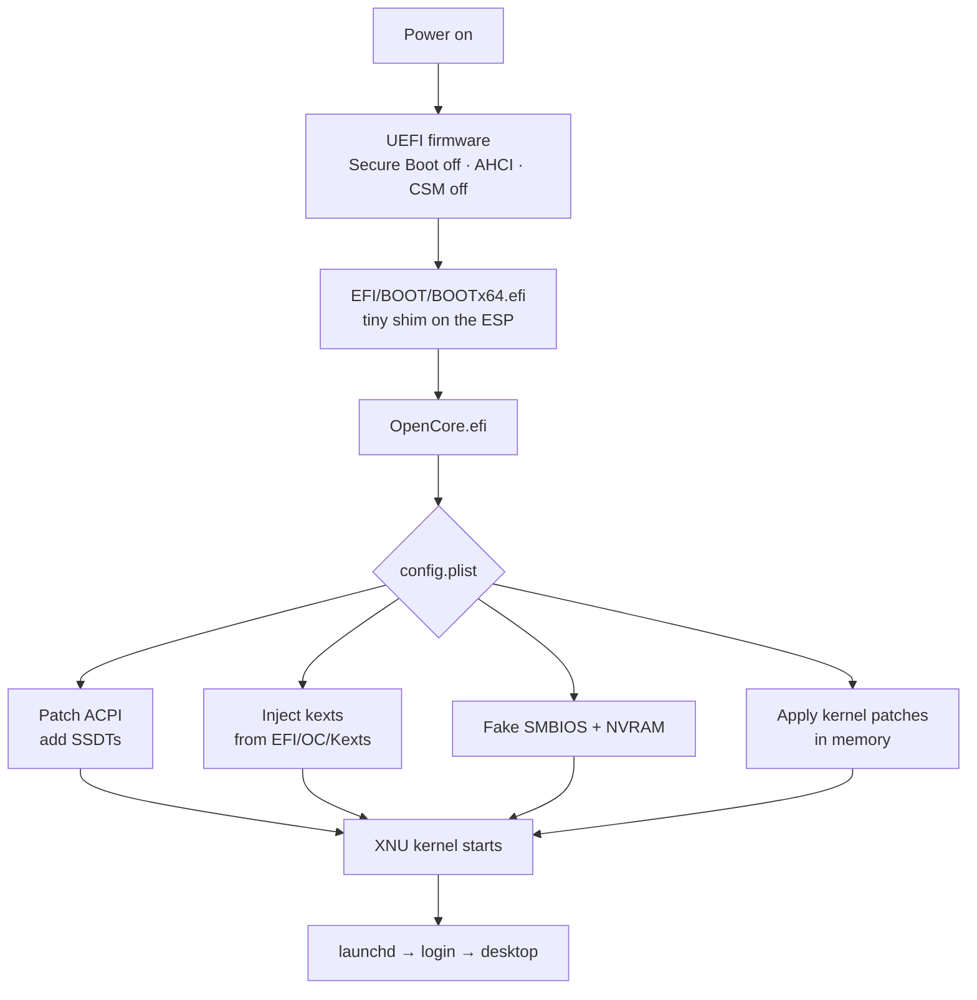
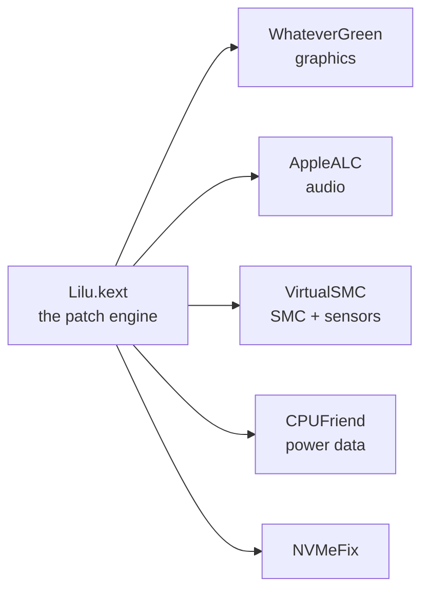
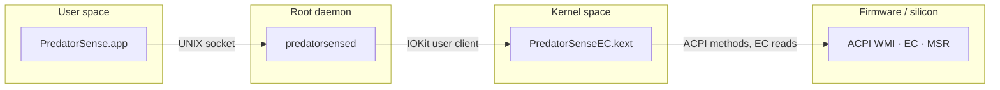

# Hackintosh 101 — how any of this actually works

If you have never done this before, read this page once. It is the mental model that makes every
other document in this repository readable. No prior knowledge assumed; jargon is defined the
first time it appears and collected again in the [glossary](#glossary).

---

## 1. The problem, in one paragraph

macOS is written for Apple's hardware. It expects a specific Apple power-management chip (the
**SMC**), Apple's own firmware tables (**ACPI**), an Apple-supported GPU, an Apple Wi-Fi card, and
a motherboard that identifies itself as a Mac. A normal PC has none of that. So a Hackintosh solves
two separate problems:

1. **Boot** Apple's kernel on hardware it was not compiled for.
2. **Pretend** well enough that macOS finds the devices and drivers it expects.

Everything in this repository is one of those two jobs.

```
   what macOS expects                    what the laptop has
   ─────────────────────                 ───────────────────
   Apple SMC chip                        no SMC
   Apple ACPI tables                     Acer/Insyde ACPI
   Apple-supported GPU                   Intel UHD 630 (supported) + dead NVIDIA
   Apple Wi-Fi (Broadcom)                Intel CNVi
   "I am a MacBookPro16,1"               "I am an Acer PT515-51"
```

The tools fill those gaps: a bootloader that patches tables and injects drivers, a fake SMC, fake
device identities, and a few custom drivers for hardware nobody documented (the PredatorSense
stack).

---

## 2. The boot chain

This is the single most useful diagram in the repository. Every boot problem lives in one of these
boxes.



| Stage | What it is | Why it fails |
|---|---|---|
| **UEFI firmware** | The PC's built-in boot code | Secure Boot rejects unsigned loaders; CSM/legacy mode hides the UEFI entry; SATA not in AHCI |
| **`BOOTx64.efi`** | A 10 KB shim that the firmware runs from the FAT32 **ESP** (EFI System Partition) | wrong filesystem, macOS `._` metadata files, missing file |
| **`OpenCore.efi`** | The bootloader — the "brain" | wrong version, corrupt config, missing driver |
| **`config.plist`** | XML settings file that tells OpenCore what to do | one wrong key stops the boot |
| **SSDTs / ACPI** | Small compiled tables that fix or extend the firmware's own tables | a bad table panics the kernel early |
| **kexts** | macOS drivers, injected from the ESP instead of installed into the system | wrong load order, wrong version, missing dependency |
| **kernel patches** | Byte-level patches applied in RAM at boot | wrong kernel version, SIP mismatch |
| **SMBIOS + NVRAM** | The identity macOS sees, and its persistent variables | bad serial → no iServices; wiped NVRAM → boot-args lost |

> **The ESP is the whole operating system's foundation.** It is a ~200 MB FAT32 partition on the
> internal disk (or on a USB stick). If it is missing or wrong, the machine does not boot. Keep a
> copy.

---

## 3. What OpenCore is actually doing

OpenCore is not "an installer" and not "a patcher". It is a **runtime environment** that sits
between the firmware and macOS and rewrites what macOS sees. It has seven jobs:

| Job | Mechanism | Example on this laptop |
|---|---|---|
| **ACPI** | Add or replace tables before the kernel reads them | `SSDT-PLUG` enables CPU power management; `SSDT-PNLF` gives the display a backlight device |
| **Kext injection** | Load drivers from the ESP, in a defined order | Lilu → VirtualSMC → WhateverGreen → AppleALC → … |
| **Kernel patching** | Patch kernel memory in place | allow unsupported CPUs, disable checks |
| **Device properties** | Give a PCI device a different ID or extra properties | `device-id = 3E9B` for the UHD 630, plus a custom EDID |
| **NVRAM** | Provide Apple's NVRAM variables and control which are deleted | `boot-args`, `csr-active-config` |
| **SMBIOS** | Present the machine as a Mac model | `MacBookPro16,1` |
| **Security** | Set SIP state and Secure Boot model | `csr-active-config = 03080000`, `SecureBootModel = Disabled` |

Everything it does is **in memory or in the ESP**. Your macOS installation stays unmodified —
that is what "vanilla" means, and it is the main reason this build survives updates.

---

## 4. The vocabulary, properly

### kext

A **kernel extension** — a driver that runs inside the kernel. `.kext` is a folder bundle, not a
file. macOS loads them at boot from the ESP (injected) or from `/System/Library/Extensions`
(installed).

The important convention in the Hackintosh world:



**Lilu must load first.** The others are plugins that register with it. Load order in
`Kernel → Add` is not cosmetic.

### SSDT / ACPI

**ACPI** is the firmware's description of the hardware: devices, power states, methods. An
**SSDT** is a small additional ACPI table you supply to fix or extend it. Examples here:

- `SSDT-PLUG` — creates the CPU object macOS needs for power management.
- `SSDT-PNLF` — creates a backlight device so brightness works.
- `SSDT-EC` — creates a fake embedded controller that macOS accepts.
- `SSDT-USBX` — declares USB power properties.

ACPI is compiled (`iasl`) and lives in `efi/OC/ACPI/`.

### DeviceProperties

A dictionary in `config.plist` keyed by PCI address, used to inject properties into a device. This
is where the iGPU gets its `ig-platform-id`, its `device-id`, and its custom EDID.

### SMBIOS

The identity table that tells macOS "I am a MacBookPro16,1". It includes the **serial number**,
**MLB** (logic board serial), **SystemUUID** and **ROM** (MAC address). Those four values are what
iMessage, FaceTime and the App Store tie a machine to. They must be **unique to you** — this
repository ships placeholders.

### NVRAM / boot-args

NVRAM is small persistent storage the firmware and macOS share. `boot-args` are kernel command-line
flags stored there (`-v` for verbose, `alcid=23` for audio layout 23, and so on). OpenCore can
**delete and rewrite** them every boot, which is why `sudo nvram boot-args=...` does not stick on
this build — edit `config.plist` instead.

### SIP, AMFI, Secure Boot model

- **SIP (System Integrity Protection)** protects system files. Its state is `csr-active-config`.
- **AMFI** checks code signatures in the kernel.
- **Secure Boot model** is Apple's Secure Boot policy.

This build sets `csr-active-config = 03080000` and `SecureBootModel = Disabled`, because the Wi-Fi
root patch and AMFIPass need them relaxed. That is a deliberate trade: more compatibility, less
system integrity. Understand it before you change it.

### ioreg / IORegistry

The live tree of every device and driver macOS knows about. `ioreg -rn DeviceName` is how you
verify that a driver actually attached. "It should work" means nothing; `ioreg` is evidence.

### ESP / EFI

The FAT32 EFI System Partition. Mounted with `sudo diskutil mount disk0s1`, it appears at
`/Volumes/EFI`. This is where OpenCore lives.

---

## 5. How macOS talks to hardware

Every hardware feature is a stack. When something does not work, find which layer is missing.



This is exactly why the PredatorSense replacement has three parts: the GUI should never touch the
kernel, and the kernel should never contain UI logic. The same layering applies to every subsystem:

| Feature | Top layer | Middle | Bottom |
|---|---|---|---|
| Graphics | WindowServer | WhateverGreen + AppleIntel driver | iGPU + EDID |
| Audio | CoreAudio | AppleALC | ALC289 codec |
| Wi-Fi | `en0` / Airport | AirportItlwm + IOSkywalkFamily | Intel CNVi |
| Battery | `pmset` / System Settings | SMCBatteryManager | EC |
| Fans | PredatorSense.app | daemon + kext | ACPI WMI |

---

## 6. The three families of problems

Almost every issue is one of these. Naming the family tells you where to look.

| Family | Symptom | Lives in |
|---|---|---|
| **Boot** | no picker, stall, panic, black screen before login | firmware settings, ESP layout, `config.plist`, ACPI, kext order |
| **Device** | boots, but no Wi-Fi / audio / trackpad / brightness | kexts, DeviceProperties, SSDTs, `boot-args` |
| **Service** | boots and works, but iMessage/updates/sleep misbehave | SMBIOS, NVRAM, SIP, Secure Boot model |

A useful rule: **if it works in the installer but not after install, suspect the ESP or SMBIOS. If
it works until an update, suspect a root patch.**

---

## 7. "Vanilla" and root patches

A **vanilla** install keeps all modifications in the ESP. macOS itself is untouched, so a system
update cannot break your drivers and a driver cannot corrupt the system.

Some features cannot be vanilla, because they need drivers that live inside macOS:

- **Intel Wi-Fi** needs `IOSkywalkFamily` / `IO80211FamilyLegacy` replacements and a **root
  patch**.
- **Audio** sometimes needs `AppleHDA` re-patched after updates.

A root patch modifies the sealed system volume. The consequences:

- It must be **re-applied after every macOS update**.
- It requires relaxed SIP.
- It is the most common reason a working build "breaks by itself" after an update.

That trade is documented per feature in [`NETWORK.md`](NETWORK.md) and [`AUDIO.md`](AUDIO.md).

---

## 8. Reading `config.plist`

The file is XML. You rarely edit it by hand — use ProperTree or `PlistBuddy` — but you should know
its seven sections:

| Section | Controls |
|---|---|
| `ACPI` | which SSDTs are added, patched or dropped |
| `Booter` | early boot memory fixes (quirks) |
| `DeviceProperties` | per-PCI-device properties, framebuffer, EDID |
| `Kernel` | kext injection, kernel patches, blocks, quirks |
| `Misc` | boot picker, debug logging, security, boot entry |
| `NVRAM` | variables to set and delete (`boot-args`, SIP) |
| `PlatformInfo` | SMBIOS identity |
| `UEFI` | drivers, protocol overrides, resolution |

Safely changing one value:

```sh
cp /Volumes/EFI/EFI/OC/config.plist ~/config-backup.plist
sudo /usr/libexec/PlistBuddy -c \
  "Set :NVRAM:Add:7C436110-AB2A-4BBB-A880-FE41995C9F82:boot-args '<new value>'" \
  /Volumes/EFI/EFI/OC/config.plist
plutil -lint /Volumes/EFI/EFI/OC/config.plist   # must say OK
```

> A malformed `config.plist` is a non-booting machine. Always lint it, always keep the previous
> copy on the USB.

---

## 9. How to learn this without breaking things

1. **Start from a known-good EFI** — this repository's `efi/`, or Dortania's guide for your
   platform.
2. **Change one thing per boot.** Two changes teach you nothing when it fails.
3. **Keep a bootable USB** that you never modify.
4. **Verify with evidence**: `ioreg`, `kmutil showloaded`, `pmset -g`, `log show`. Not with
   "should".
5. **Write down what failed**, not just what worked. The failures are the expensive part.
6. **Read the vendor-neutral guides** at [Dortania](https://dortania.github.io/OpenCore-Install-Guide/)
   for general theory, then come back here for this machine's specifics.

The full method used to build this machine, including how AI assistants were used and where they
were wrong, is in [`AI-WORKFLOW.md`](AI-WORKFLOW.md).

---

## 10. Glossary

| Term | Meaning |
|---|---|
| **ACPI** | Firmware tables describing devices, power and methods |
| **AMFI** | Apple's in-kernel code-signing enforcement |
| **boot-args** | Kernel command-line flags stored in NVRAM |
| **CNVi** | Intel's integrated Wi-Fi MAC; not a removable PCIe card |
| **csr-active-config** | SIP configuration bitmask (NVRAM) |
| **DTD** | Detailed Timing Descriptor — one resolution/refresh entry inside an EDID |
| **EC** | Embedded Controller — the laptop's own microcontroller |
| **EDID** | The 128-byte description a display sends to the GPU |
| **EFI/ESP** | The FAT32 boot partition holding OpenCore |
| **IOKit** | macOS's driver framework; kexts are IOKit drivers |
| **ioreg** | Tool that prints the live IORegistry device tree |
| **kext** | Kernel extension (driver) |
| **Lilu** | Patch engine that other kexts plug into; loads first |
| **MSR** | Model-Specific Register — CPU control registers (power limits, etc.) |
| **NVRAM** | Small persistent firmware/OS variable store |
| **OpenCore** | The bootloader used by this build |
| **plist** | Apple's XML/property-list format; `config.plist` is one |
| **root patch** | Modification of the sealed macOS system volume |
| **SIP** | System Integrity Protection |
| **SMC** | Apple's power/thermal controller chip; VirtualSMC fakes it |
| **SMBIOS** | The identity table macOS reads (model, serial, UUID) |
| **SSDT** | A supplemental ACPI table |
| **UEFI** | Modern PC firmware interface; must be in UEFI mode, not CSM |
| **WMI** | Windows Management Instrumentation — here, Acer's ACPI control interface for fans/RGB |

---

## 11. The one thing to remember

> **The machine is the source of truth.** Every confident-sounding explanation, including one from
> an AI, is a hypothesis until the hardware confirms it.

This project's most expensive mistakes were all plausible ideas that nobody tested. The corrections
all came from a measurement: a Linux live USB, an ACPI dump, an EC read, an MSR read. That habit is
the actual skill.
