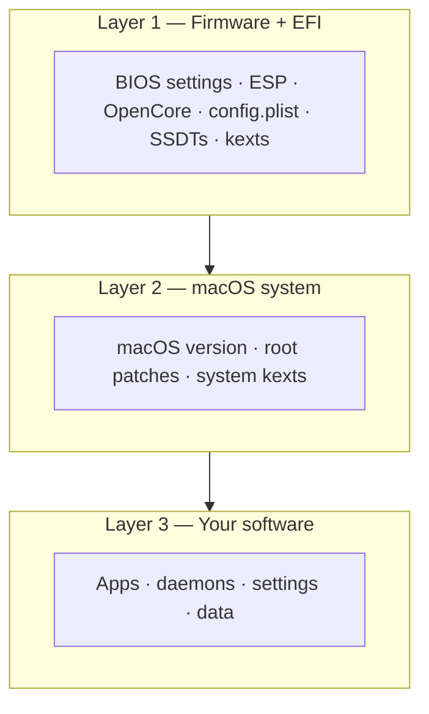
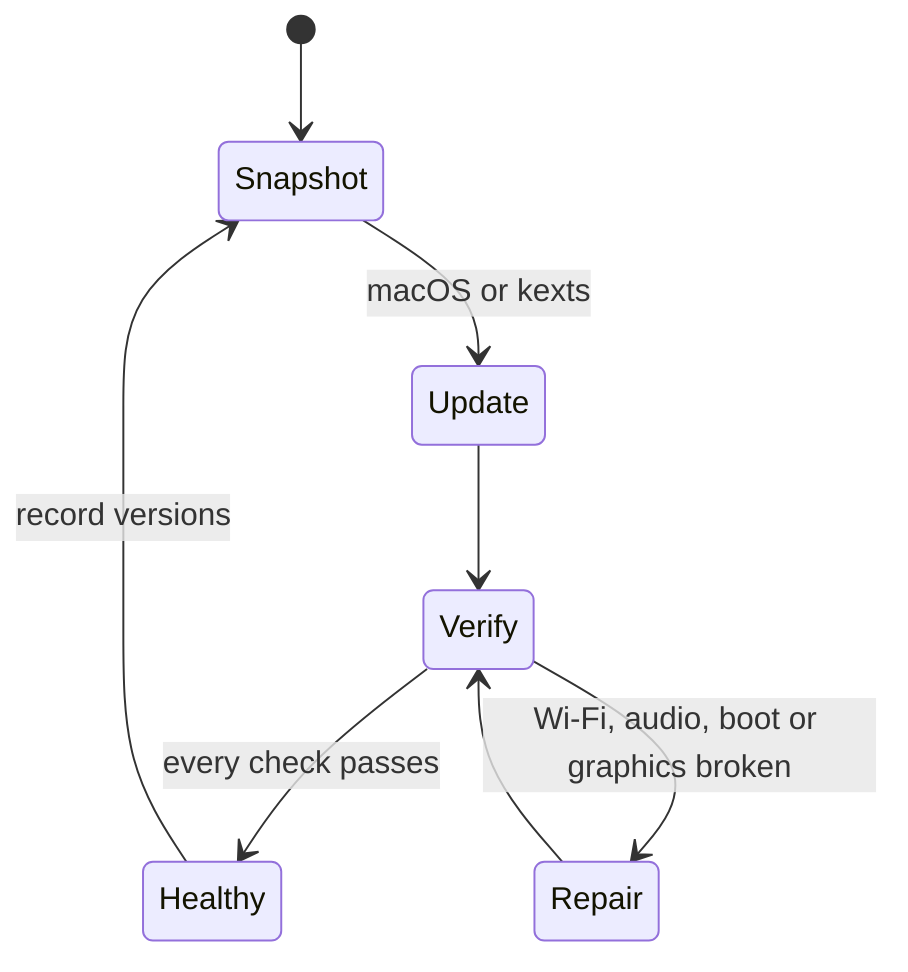
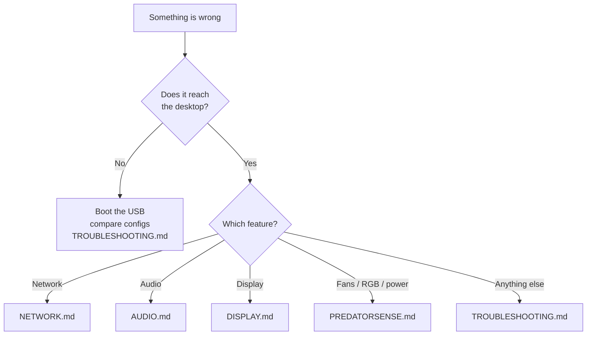

# Stability — how to keep it working

A Hackintosh is stable when three things are true:

1. It **boots every time**, without a USB stick.
2. Its features **survive macOS and kext updates** — or you know exactly how to restore them.
3. You can **recover in ten minutes** from any mistake, because you kept the pieces.

This page is the playbook for all three. It is written from the failures recorded in this project,
not from general advice.

---

## The stability model

Treat the machine as three layers. A change belongs to exactly one of them, and you change one
layer at a time.



| Layer | Changes when | Recovery |
|---|---|---|
| **1 — EFI** | you edit it, deliberately | swap the EFI folder back; boots in minutes |
| **2 — macOS** | Apple updates it, or you root-patch it | re-apply patch, or reinstall over the top |
| **3 — apps** | you install things | uninstall; rarely affects boot |

Most "my Hackintosh broke" stories are a layer-2 change (an update wiped a root patch) or a
layer-1 change made without a backup. Almost none are layer 3.

---

## The golden rules

| # | Rule | Why it matters here |
|---|---|---|
| 1 | **Never update macOS without a tested EFI backup** | Every point update wipes the Wi-Fi root patch and can change audio |
| 2 | **Keep one USB stick that boots and never modify it** | It is your only guaranteed entry point |
| 3 | **One variable per boot** | Two changes at once make a failure unreadable |
| 4 | **Change layer 1 only from a working system, with the new EFI on the USB first** | If the new EFI fails, the USB is the fallback |
| 5 | **Lint every plist you touch** | `plutil -lint` catches the non-booting typo |
| 6 | **Update kexts in sets, not one at a time** | Lilu and its plugins are version-coupled |
| 7 | **Never flash the BIOS** | V1.13 is what everything was reverse-engineered against; there is no flashback |
| 8 | **Write down what you changed** | Future you (and any assistant) has no memory |

---

## Backups: the ladder

You need three copies of the EFI, in three places, and one of them must be offline.

```
   internal ESP      →  working copy, changes here
   USB stick         →  known-good, never edited
   external / cloud  →  dated snapshots, restorable
```

### Take a snapshot before every change

The repository includes a script that copies the live ESP, records versions and writes checksums:

```sh
chmod +x tools/backup-efi.sh
sudo ./tools/backup-efi.sh
```

Output goes to `~/Hackintosh-Backups/EFI-YYYYMMDD-HHMMSS/` with:

```
OC/                 the whole OpenCore folder
BOOT/               BOOTx64.efi
MANIFEST.txt        macOS build, OpenCore version, boot-args, every kext version
SHA256SUMS.txt      integrity check
```

Verify a snapshot later:

```sh
cd ~/Hackintosh-Backups/EFI-20261118-210000
shasum -a 256 -c SHA256SUMS.txt
```

### Restore it

```sh
sudo diskutil mount disk0s1
sudo rm -rf /Volumes/EFI/EFI/OC /Volumes/EFI/EFI/BOOT
sudo cp -R ~/Hackintosh-Backups/EFI-YYYYMMDD-HHMMSS/OC \
           ~/Hackintosh-Backups/EFI-YYYYMMDD-HHMMSS/BOOT /Volumes/EFI/EFI/
sudo dot_clean -m /Volumes/EFI
```

Then reboot. If the machine will not boot at all, do the same thing from a Linux live USB or from
another Mac — the ESP is just a FAT32 partition.

### Also back up

- the **macOS installer** you used (Apple removes old versions),
- `~/Library/ColorSync/Profiles/Triton500.icm` if you calibrated,
- `/Library/Application Support/PredatorSense/state.json` (root-only) if you tuned fans/RGB,
- **this repository** — it is the documentation for all of the above.

### Bootable clone with SuperDuper! (verified 2026-11-20)

A full bootable clone of 26.7.3 (25G342) was made from the internal APFS startup volume to an
external 274.9 GB APFS container with SuperDuper! 4. It is a valid second bootable system, not just
a file backup. Sequence that worked:

1. Create the destination with `diskutil addPartition disk2s2 APFS "macOS Clone" 0` (uses the
   unallocated space after Multimedia; `0` = fit to fill).
2. In SuperDuper!, select the internal `MacOS` volume as source and `macOS Clone` as destination,
   and use the **Bootable Mirror** job. It runs in three phases: prepare destination, replicate
   volumes, make destination bootable.
3. SuperDuper! rebuilds a full APFS volume group (System, Data, Preboot, Recovery). It skips the
   EFI partition — copy the OpenCore ESP separately if the clone must boot independently.
4. Set `ScanPolicy` to `19860739` (`0x12F0D03`) so the OpenCore picker can see the USB disk.
   With the old `17763587`, boot the clone via the firmware F12 menu instead.
5. On first boot of the clone, re-apply OCLP root patches and the OCLP-Mod Intel Wi-Fi patch.

**OCLP root patches and cloning:** SuperDuper! uses Apple's `asr`, which cannot reliably replicate a
system volume whose seal is broken by root patches. The conventional workaround is to revert root
patches, reboot, clone, then re-apply patches on the clone. In this run the source was already
reverted (`Sealed: Yes`) before the copy and the clone's System volume came out `Sealed: Broken`
with a valid update snapshot — so the clone inherited the patched state. Check both volumes with
`diskutil info <system-slice> | grep -i sealed` and re-apply patches on whichever one is broken
or missing Wi-Fi.

**Verification performed on the clone:**

- Volume group present with correct roles: System 12.6 GB, Data 195.5 GB, Preboot 10.9 GB,
  Recovery 1.5 GB; `SystemVersion.plist` reports 26.7.3 / 25G342, matching the source.
- File counts match for Applications (78 top-level, 80 `.app`), Desktop (59,487), Documents
  (36,281), Pictures (2,755), Music (137). Dotfiles and `.zshrc` checksums match.
- Expected point-in-time differences only: the two install ISOs remain in the clone's `Downloads`
  because they were moved to `/Volumes/Multimedia/OS ISOs` after the snapshot; `.GlobalPreferences.plist`
  changed on the source after the copy (live preferences keep changing). Neither is corruption.

---

## The update playbook

This is the cycle that keeps a build alive. Do not skip the snapshot.



### Before

```sh
sudo ./tools/backup-efi.sh
softwareupdate -l                 # what is actually offered
```

Confirm the USB still boots **before** updating, not after.

### During — macOS point update

```sh
sudo softwareupdate -ia --restart
```

Expect several reboots. Do not interrupt. Do not "clean install to be safe" unless you were going
to anyway.

### After — the five checks

Run these in order. Each maps to a feature that updates break.

```sh
# 1. Boot and identity
sw_vers
nvram 4D1FDA02-38C7-4A6A-9CC6-4BCCA8B30102:opencore-version

# 2. Network (the most common casualty)
ifconfig en0 | grep 'inet '
networksetup -listallhardwareports | grep -A2 Wi-Fi

# 3. Audio
system_profiler SPAudioDataType | head -20

# 4. Graphics and modes
system_profiler SPDisplaysDataType | head -15

# 5. Everything else
./tools/pt515-healthcheck.sh
./tools/bluetooth-check.sh || true
```

| Check | Healthy result | If it fails |
|---|---|---|
| Network | `en0` has an IPv4 address | re-apply the Intel Wi-Fi root patch — [`NETWORK.md`](NETWORK.md#the-part-that-breaks-after-updates) |
| Audio | built-in output and input present | check `alcid=23`, re-patch AppleHDA — [`AUDIO.md`](AUDIO.md) |
| Graphics | UHD 630, Metal 3, 144/120/90 Hz | check DeviceProperties and WhateverGreen — [`TROUBLESHOOTING.md`](TROUBLESHOOTING.md) |
| Bluetooth | radio present; controller may be off until toggled | `tools/bluetooth-check.sh`; if the radio is absent, cold boot — [`NETWORK.md`](NETWORK.md#bluetooth) |
| PredatorSense | `echo status \| nc -U /var/run/predatorsense.sock` returns `"ok":true` | [`PREDATORSENSE.md`](PREDATORSENSE.md) |

Bluetooth is the one check where a failed update can look like a driver problem but is not. The
firmware kext loads only after the USB radio enumerates. If the check reports the radio absent, do
a cold boot before touching the EFI: no kext or config change can create a missing USB device.

### Kext update policy

- Update **Lilu and its plugins together**, as a set, from the same release window.
- Read the release notes for **VirtualSMC, WhateverGreen and AppleALC** — they occasionally change
  required `boot-args`.
- Update **one set per boot**, snapshot, verify, then the next.
- Do not update a kext "because it is newer" if the machine is healthy. No release fixes a problem
  you do not have.
- Keep the previous `.kext` next to the new one until the machine has booted twice.

### Never update

- **BIOS.** V1.13 is the version this build's ACPI and EC work was measured against. There is no
  flashback recovery on this model.
- **The macOS major version** unless you accept that every patch must be redone. See
  [`MACOS27.md`](MACOS27.md) — macOS 27 will not run on this hardware at all.

---

## Monitoring: five minutes a week

Cheap checks catch degradation before it becomes an outage.

| What | Command | Expected |
|---|---|---|
| Loaded third-party kexts | `kmutil showloaded --list-only \| grep -v com.apple` | all present, versions match the manifest |
| Battery | `ioreg -rn AppleSmartBattery \| grep -E 'CycleCount\|MaxCapacity'` | cycles slowly rising; capacity slowly falling |
| Thermal / power | `pmset -g therm` | no `CPU_Speed_Limit` below 100 |
| Sleep assertions | `pmset -g assertions` | no unexpected `PreventUserIdleSystemSleep` |
| Disk health | `diskutil verifyVolume /` | no errors |
| Free space | `df -h /` | > 15 % free |
| Panic history | `ls -lt /Library/Logs/DiagnosticReports \| head` | no recent `.panic` |
| PredatorSense | `echo status \| nc -U /var/run/predatorsense.sock` | `"ok":true`, fans sane |

A monthly `tools/collect-hackintosh-audit.sh` run gives you a dated record you can compare against
the previous month. **Review it before sharing** — it can contain serials and UUIDs.

---

## What destabilises *this* machine

Every item below was observed on the reference unit.

| Destabiliser | Effect | What to do |
|---|---|---|
| **CleanMyMac / "optimisers"** | LaunchDaemons, FinderSync extensions, constant background CPU and wake assertions | uninstall them; they are a common cause of "mystery" slowness |
| **Spotlight indexing external USB** | constant USB churn, slow builds, more wake events | System Settings → Spotlight → Privacy: exclude the external volumes |
| **External USB project volume (exFAT)** | ~354 MB/s and metadata problems; builds 4–6× slower than the NVMe | keep a working copy on the internal APFS disk |
| **USB devices during sleep** | instant wake with the lid open; drives drop off the bus | unplug, or close the lid; see [`TROUBLESHOOTING.md`](TROUBLESHOOTING.md#sleep-wakes-instantly-lid-open) |
| **Degraded battery** | "Service Recommended", ~76 % capacity; limits peak power, can shut down under load | replace it if you need sustained performance on battery |
| **Manual fans at 100 %** | loud, dust ingress, no benefit at idle | leave auto; manual is for sustained load |
| **Beta macOS builds** | kexts lag by weeks; Wi-Fi and Bluetooth break first | stay on release builds |
| **Mixing root-patch variants** | OCLP / OCLP-Mod / forks overwrite each other's files | pick one, record which, re-apply only that one |
| **Random scripts from chat answers** | EC writes can hang the machine | only run code you can read and attribute |
| **Editing the live EFI with no backup** | a typo is a non-booting laptop | snapshot first, USB always |

---

## When it breaks: first action by symptom



| Symptom | First action | Then |
|---|---|---|
| No picker | check BIOS (Secure Boot, CSM), USB is FAT32, `dot_clean` | [`TROUBLESHOOTING.md`](TROUBLESHOOTING.md#the-opencore-picker-does-not-appear) |
| Stall or panic | boot `-v`, photograph the last line | [`TROUBLESHOOTING.md`](TROUBLESHOOTING.md#the-machine-will-not-boot--stalls-at-the-apple-logo) |
| Black internal screen | close lid, sleep, reopen | [`DISPLAY.md`](DISPLAY.md#intermittent-blank-panel-on-restart--open-low-severity) |
| No Wi-Fi after update | re-apply the root patch | [`NETWORK.md`](NETWORK.md) |
| No audio | check `alcid=23` and layout 23 | [`AUDIO.md`](AUDIO.md) |
| Trackpad lag | confirm `-vi2c-force-polling` | [`BUILD-REFERENCE.md`](BUILD-REFERENCE.md) §9 |
| Fans stuck | `echo "fanmode auto" \| nc -U /var/run/predatorsense.sock` | [`PREDATORSENSE.md`](PREDATORSENSE.md) |

---

## Recovery, in order of escalation

1. **Undo the last change.** Restore the previous config or kext from the snapshot. This solves
   most problems and costs two minutes.
2. **Boot the USB.** Mount the internal ESP and restore the whole `OC` folder.
3. **Reset NVRAM** from the OpenCore picker (space bar → Reset NVRAM) if boot-args or SIP seem
   corrupt.
4. **Boot safe mode** (`-x`) to disable non-essential kexts and see whether the problem is a
   driver.
5. **Reinstall macOS over the top.** This keeps data and user accounts; it resets the system
   volume, so root patches must be re-applied afterwards.
6. **Erase and restore from backup.** Last resort, and the reason for the backup ladder.

---

## Long-term health

| Item | Guidance |
|---|---|
| **Thermals** | The EC enforces PL1 = 45 W. Do not chase more; keep vents clean and use auto fans |
| **Battery** | A degraded battery limits peak power. Replace before relying on battery performance |
| **Display** | 120 Hz is the best balance for this iGPU; 144 Hz costs more WindowServer work |
| **Storage** | Keep > 15 % free; avoid running builds from exFAT over USB |
| **Dust** | Laptop fans at 100 % pull dust in fast; clean every 6–12 months |
| **Documentation** | Update [`KNOWN-GOOD.md`](../reference/KNOWN-GOOD.md) whenever a verified change lands |

---

## Definition of done

A stable machine passes all of these:

- [ ] Boots from the internal ESP with the USB unplugged
- [ ] Wi-Fi, audio, trackpad, brightness, battery, sleep work
- [ ] `tools/pt515-healthcheck.sh` reports expected values
- [ ] PredatorSense daemon answers `status` with `"ok":true`
- [ ] A dated EFI snapshot exists, with a verified checksum
- [ ] A USB stick boots the same EFI
- [ ] `reference/KNOWN-GOOD.md` lists the exact versions in use
- [ ] You know which root patches are applied and how to re-apply them
