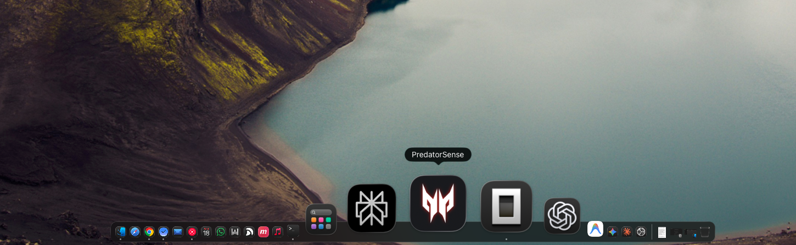
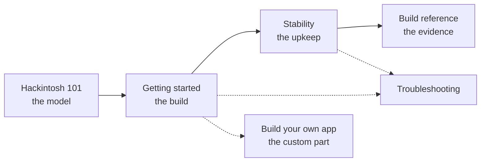

# Start here

This repository is the complete record of one working Hackintosh: an **Acer Predator Triton 500
(PT515-51)** running **macOS Tahoe 26.7.3**, including the EFI, every patch, a replacement for
Acer's Windows-only PredatorSense software, custom audio, display work, and the measurements that
made it all work.

---

## Pick your path

| I want to… | Read | Time |
|---|---|---|
| **Understand what a Hackintosh is** | [Hackintosh 101](HACKINTOSH-101.md) | 20 min |
| **Build this on the same laptop** | [Getting started](GETTING-STARTED.md) | 1–2 h |
| **Build my own hardware-control app** | [Build your own PredatorSense](BUILD-YOUR-OWN-APP.md) | 1–2 h |
| **Keep an existing build stable** | [Stability](STABILITY.md) | 20 min |
| **Fix one specific thing** | [Troubleshooting](TROUBLESHOOTING.md) | 5 min |
| **Understand this machine deeply** | [Build reference](BUILD-REFERENCE.md) | reference |
| **Work on it with an AI assistant** | [AI workflow](AI-WORKFLOW.md) | 15 min |
| **Know whether macOS 27 is possible** | [macOS 27](MACOS27.md) | 5 min |

---

## The 60-second summary

| | |
|---|---|
| **Machine** | Acer Predator Triton 500, PT515-51, i7-8750H, UHD 630, ALC289, Intel CNVi |
| **OS** | macOS Tahoe 26.7.3 (25G342) |
| **Bootloader** | OpenCore 1.0.8, SMBIOS `MacBookPro16,1` |
| **Works** | graphics, audio, Wi-Fi, Ethernet, battery, sleep (with the USB caveat), trackpad, 144/120/90 Hz, keyboard backlight, fans, RGB, power profiles |
| **Does not work** | the dead NVIDIA GPU (hardware), special media keys (firmware), AirDrop/Continuity (itlwm limitation), macOS 27 (Apple Silicon only) |
| **Open items** | Bluetooth controller state is inconsistent; instant wake from USB with the lid open has a workaround only |

---

## What is in the repository

| Folder | Contents |
|---|---|
| [`efi/`](../efi/) | The live OpenCore EFI: config, 25 kexts, 7 SSDTs, drivers, resources |
| [`predatorsense/`](../predatorsense/) | PredatorSense replacement: kext sources, root daemon, SwiftUI menu-bar app, build script |
| [`audio/`](../audio/) | Custom AppleALC ALC289 layout 23: EQ, gain, limiter, mic boost, mute fix, reproducible patch |
| [`display/`](../display/) | Native EDID with 144/120/90 Hz, banding tests, panel audits, generator |
| [`docs/`](.) | Everything you are reading |
| [`tools/`](../tools/) | Health check, Bluetooth diagnosis, audit collector, EFI backup, release packaging and verification, Linux capture scripts |
| [`linux-evidence/`](../linux-evidence/) | Linux cross-check evidence used to settle hardware questions |
| [`reference/`](../reference/) | Historical handovers, the optimisation review, the known-good manifest |

---

## Safety first

- **Back up** your EFI and your data. Read [Stability](STABILITY.md) before updating anything.
- **Verify what you download.** Release binaries are ad-hoc signed, not notarised — use
  [Signing](SIGNING.md) and `tools/verify-release.sh` before installing.
- The shipped `config.plist` contains **placeholder** serial, MLB, UUID and ROM. Generate your own
  before signing in to iCloud — see [Getting started](GETTING-STARTED.md#generate-your-own-smbios-identity).
- This is one machine's configuration. The same model number with a different panel, Wi-Fi card or
  EC revision needs different patches. Compatibility is per model and per firmware revision.
- Installing macOS on non-Apple hardware is unsupported by Apple. You are responsible for licences,
  data and damage.

---

## How this was built

Not by following one guide. By measuring the hardware, testing one change at a time, and recording
both the successes and the dead ends. The full method — including where AI assistants were useful
and where they were confidently wrong — is in [AI workflow](AI-WORKFLOW.md), and the list of
approaches that **do not work on this machine** is in
[Build reference §12](BUILD-REFERENCE.md#12-rejected-approaches--do-not-retry-without-new-evidence).

> If you take one habit from this project: **the machine is the source of truth.**
